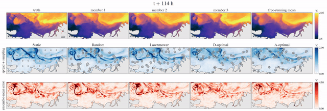

# Closed-Loop Adaptive Sampling on a Generative Ocean Model

Shayesteh Hafezi, Alan Papalia — University of Michigan

[](https://arxiv.org)
[](https://huggingface.co/shafezi/closed-loop-sampling)
[](https://huggingface.co/datasets/shafezi/closed-loop-sampling-artifacts)



A multi-robot closed-loop adaptive sampling framework that uses a single
learned generative ocean model for forecasting, uncertainty estimation,
planning, and measurement assimilation. The model forecasts an analysis
ensemble in latent space, decodes it to physical ocean states, and uses
ensemble statistics to construct A- or D-optimal acquisition scores; sampling
locations are selected under robot reachability constraints from predicted
currents, and the collected measurements are assimilated back into the latent
state by observation-conditioned diffusion sampling. The loop is evaluated on
two ROMS reanalysis regions — the Mid-Atlantic Bight (MAB, Doppio) and the
California Current System (CCS, CCSRA31) — over 120 test cases (2 regions x
2 variables x 3 fleet sizes x 10 sealed initial conditions), 5 policies x
3 paired seeds each.


**Results.** Uncertainty-driven sampling generally outperforms static, random
and systematic-coverage baselines while adding little planning overhead:
A-optimal removes 38/47/61 percent of the recoverable MAB temperature error at
fleet sizes 20/50/200 (final-eight-cycle window); the median full
forecast-plan-assimilate cycle takes 123 s on MAB and 151 s on CCS on a single
NVIDIA A40 in bf16, inside a six-hour observation interval; and across the
1,800-run campaign every printed number in the paper's three tables regenerates
from the released per-run scores (verified cell by cell, 466/466).

## Paper-to-code map

| paper element | where | regenerate |
|---|---|---|
| Alg. 1 (the closed loop) | `src/closedloop_sampling/closed_loop.py` | `python experiments/run_closed_loop.py --region mab --ic_datetime 2022-04-09T12:00 --nfleet 50 --strategy a_optimal --rseed 0` |
| Eq. (1)-(2) acquisition scores | `src/closedloop_sampling/sampling/acquisition.py`, `src/closedloop_sampling/sampling/uncertainty.py` | exercised by `tests/test_acquisition.py` |
| greedy assignment + planning update | `src/closedloop_sampling/sampling/selection.py` | parity-tested in `tests/test_selection_parity.py` |
| the five policies | `src/closedloop_sampling/sampling/policies/` | `tests/test_policies.py` |
| reachability under predicted currents | `src/closedloop_sampling/sampling/reachability.py` | `tests/test_reachability.py` |
| observation model (Sec. III-C) | `src/closedloop_sampling/observations.py` | bit-exactness proof in `tests/test_observations.py` |
| observation-conditioned diffusion update | `src/closedloop_sampling/assimilation/guidance.py` | GPU; part of any chain run |
| forecaster (EDM, loop ensemble convention) | `src/closedloop_sampling/forecast/` | equivalence suite `tests/test_equivalence.py` |
| guidance-scale selection (frozen) | `experiments/select_guidance_scale.py`, `configs/experiments/guidance_scales.yaml` | values released; sweep re-runnable on GPU |
| sealed test ICs | `configs/experiments/ics/test_{mab,ccs}.json` | shipped as data (selection inputs were deleted before unsealing) |
| campaign enumeration (2,410 chains) | `experiments/launch_sweep.py` | `python experiments/launch_sweep.py --dry-run` |
| per-run scores and references | `results/scores/` | `python tools/extract_scores.py --source-root <production tree>` (author-side) |
| scoring conventions (window means, skill fraction F, floors, Wilcoxon) | `results/scoring/` | imported by the tables and Fig. 3-4 |
| Table I (campaign score) | `results/tables/table1_rmse.py` | `python results/tables/table1_rmse.py` |
| Table II (per-IC r and Delta) | `results/tables/table2_per_ic.py` | `python results/tables/table2_per_ic.py` |
| Table III (Lawnmower wins) | `results/tables/table3_lawnmower_wins.py` | `python results/tables/table3_lawnmower_wins.py` |
| Fig. 1 (method overview) | `results/figures/fig1_overview.py` | needs `$CLOSEDLOOP_ARTIFACTS` |
| Fig. 2 (ensemble and error) | `results/figures/fig2_ensembles.py` | needs `$CLOSEDLOOP_ARTIFACTS` |
| Fig. 3 (recoverable error removed) | `results/figures/fig3_skill.py` | `python results/figures/fig3_skill.py` (scores only) |
| Fig. 4 (fleet size) | `results/figures/fig4_fleet_size.py` | `python results/figures/fig4_fleet_size.py` (scores only) |
| Fig. 5 (where policies sample) | `results/figures/fig5_locations.py` | `python results/figures/fig5_locations.py` (scores only) |
| Fig. 6 (confidently wrong) | `results/figures/fig6_confidently_wrong.py` | needs `$CLOSEDLOOP_ARTIFACTS` |
| loop video / teaser | `results/figures/teaser_video.py` | needs `$CLOSEDLOOP_ARTIFACTS` + ffmpeg |
| spread-error correlation r | `results/scores/references/spread_error_r.csv` | released values (recompute needs the free-running latents in the artifacts dataset) |
| rerun-tolerance floors | `results/scores/references/tolerance.csv` | recomputed from the replicate chains and asserted by `tools/extract_scores.py` |
| golden verification vs the submitted tables | `tools/verify_tables_vs_tex.py` | author-side (needs the submission archive); result: 466/466 cells match |

## Installation

```
git clone <this repository> && cd closed-loop-sampling
pip install -e .                      # pinned to the production freeze
pip install -e .[figures,dev]         # matplotlib + cmocean, pytest
python tools/fetch_upstream.py        # pins LaDCast into third_party/ (verified)
export CLOSEDLOOP_WEIGHTS=...  CLOSEDLOOP_ARTIFACTS=...
python tools/download_weights.py
python tools/download_artifacts.py --bundles-only   # ~320 MB; omit the flag for all 2.3 GB
pytest                                # CPU subset; weights probes run where weights exist
```

## Data

Both reanalyses are public products; nothing here mirrors them.

- MAB: Doppio reanalysis (Wilkin et al., 2022), ~3.3 TB of raw NetCDF via
  `datasets/download_mab.sh`, preprocessed to a 940 GB store.
- CCS: CCSRA31 (Neveu et al., 2016), ~2.5 TB staged over OPeNDAP via
  `datasets/download_ccs.py`, preprocessed to a 381 GB store.

The small path: the released **truth bundles** (the 10 sealed test windows per
region: 41 six-hour states of SST, SSS and surface currents, ~110 MB/region)
and **latent bundles** (the same windows as raw fp16 latents, ~30 MB/region)
let the closed loop, the scoring and the figures run without any store. Truth
bundles are bitwise equal to the stores; latent bundles carry ~5e-4 relative
fp16 quantization (see AS-RUN NOTES). Redistribution terms are stated in the
dataset card and `datasets/README.md`.

## Weights

`huggingface.co/shafezi/closed-loop-sampling` (placeholder until published):
safetensors EMA checkpoints for both regions — autoencoder 256,388,460
parameters, denoiser 374,938,452 parameters — each with its as-run training
configuration and provenance metadata, plus seed-1 denoiser extras that no
paper result uses. The equivalence suite must reproduce the recorded probe
statistics (1e-5) and rounded-array hashes with these files.

## Reproduction tiers

**Tier 1 — tables and score figures from the released scores (minutes, CPU).**
```
python results/tables/table1_rmse.py
python results/tables/table2_per_ic.py
python results/tables/table3_lawnmower_wins.py
python results/figures/fig3_skill.py
python results/figures/fig4_fleet_size.py
python results/figures/fig5_locations.py
pytest tests/test_tables_regenerate.py   # regeneration equals the committed goldens
```
No downloads needed: `results/scores/` is committed.

**Tier 2 — run closed-loop chains on the released bundles (one GPU;
1.4 h per MAB chain, 1.7 h per CCS chain).**
```
python tools/download_weights.py && python tools/download_artifacts.py
python experiments/run_closed_loop.py --region mab \
    --ic_datetime 2022-04-09T12:00 --nfleet 50 --strategy a_optimal --rseed 0
python experiments/run_free_running.py --region mab --target temp
python results/figures/fig1_overview.py      # and fig2 / fig6 / teaser_video
```
bf16 generation is not bit-stable across GPU models and the bundles are fp16,
so a rerun reproduces the released records statistically (cycle-level RMSE
magnitudes and gaps), not bitwise.

**Tier 3 — the full campaign, or retraining (cluster scale).**
```
python experiments/launch_sweep.py           # emits all 2,410 chain commands
```
The 1,800-run campaign matrix costs about 2,800 GPU-hours on A40-class
hardware (plus roughly 800 more for the fleet sweep, replicate floors and
free-running references). Retraining from scratch needs the multi-terabyte
raw mirrors and preprocessed stores above (`datasets/README.md`, then
`training/README.md`); retrained weights are new draws of the optimization and
**will not reproduce the reference hashes** — those identify the released
checkpoints only.

## As-run notes

1. The released `guidance_scales.yaml` carries the selected value **0.0217**
   for CCS SSS at n = 20/35 (a second-stage endpoint extension of the sweep
   grid); the paper prose rounds it to 2.2e-2.
2. The guidance scales were tuned under a 144 h single-shot conditioning
   protocol on 15 tuning-year ICs per region, then frozen and applied in the
   6 h closed loop.
3. D-optimal ranks candidates by the marginal-variance surrogate, which is
   argmax-equivalent to the paper's Eq. (1) information gain; per-placement
   scores stored in the records are variances, not log-gains.
4. The executed observation-noise literals are sigma_SST = 0.2 degC and
   sigma_SSS = 0.2 * 3.6912 / 5.1723 = 0.14272954004988112 psu (equal relative
   precision anchored at SST; both regions).
5. The initial ensemble is N = 25 identical copies of the normalized IC
   latent; member spread is created by the first generative roll.
6. The production SST code path carried a numerically inert legacy SSS misfit
   term (y = 0, sigma = 1e3, about 4e-8 relative weight), kept there only for
   bit-exact regression against an earlier pipeline; this release implements
   the target-only misfit and documents the omission in
   `src/closedloop_sampling/assimilation/guidance.py`.
7. `scale_eff` recorded in every run file is the launcher's `--scale` verbatim:
   a fixed guidance scale with a constant schedule, no per-cycle adaptation and
   no observation-count normalization.

**Limitations.** The loop is evaluated against the reanalyses it was trained
on, with synthetic point observations of one surface variable per campaign;
ensemble spread can diverge from forecast error on individual dates (Fig. 6 and
Table II quantify this), and no real-vehicle constraints beyond reachability
are modeled.

## Citations

```bibtex
@inproceedings{hafezi2027closedloop,
  author = {Hafezi, Shayesteh and Papalia, Alan},
  title  = {Closed-Loop Adaptive Sampling on a Generative Ocean Model},
  year   = {2027},
  note   = {Under review},
}
@misc{zhuang2025ladcast,
  author        = {Zhuang, Yilin and Duraisamy, Karthik},
  title         = {{LaDCast}: A Latent Diffusion Model for Medium-Range Ensemble Weather Forecasting},
  year          = {2025},
  howpublished  = {arXiv preprint arXiv:2506.09193},
}
@article{wilkin2022doppio_reanalysis,
  author  = {Wilkin, John and Levin, Julia and Moore, Andrew and Arango, Hernan and L{\'o}pez, Alexander and Hunter, Elias},
  title   = {A Data-Assimilative Model Reanalysis of the {U.S.} {Mid Atlantic Bight} and {Gulf of Maine}},
  journal = {Progress in Oceanography},
  volume  = {209},
  pages   = {102919},
  year    = {2022},
}
@article{neveu2016ccsra,
  author  = {Neveu, Emilie and Moore, Andrew M. and Edwards, Christopher A. and Fiechter, J{\'e}r{\^o}me and Drake, Patrick and Crawford, William J. and Jacox, Michael G. and Nuss, Emma},
  title   = {An Historical Analysis of the {California Current} Circulation Using {ROMS} {4D-Var}: System Configuration and Diagnostics},
  journal = {Ocean Modelling},
  volume  = {99},
  pages   = {133--151},
  year    = {2016},
}
```

## License

MIT (code, released weights, and original released data). The forecaster
architecture derives from LaDCast, which is dual-licensed (Apache-2.0 for code
adapted from third-party sources, MIT otherwise); the upstream code is **not
redistributed** here — `tools/fetch_upstream.py` fetches the pinned commit into
the gitignored `third_party/` and verifies it against `configs/upstream.lock`.
